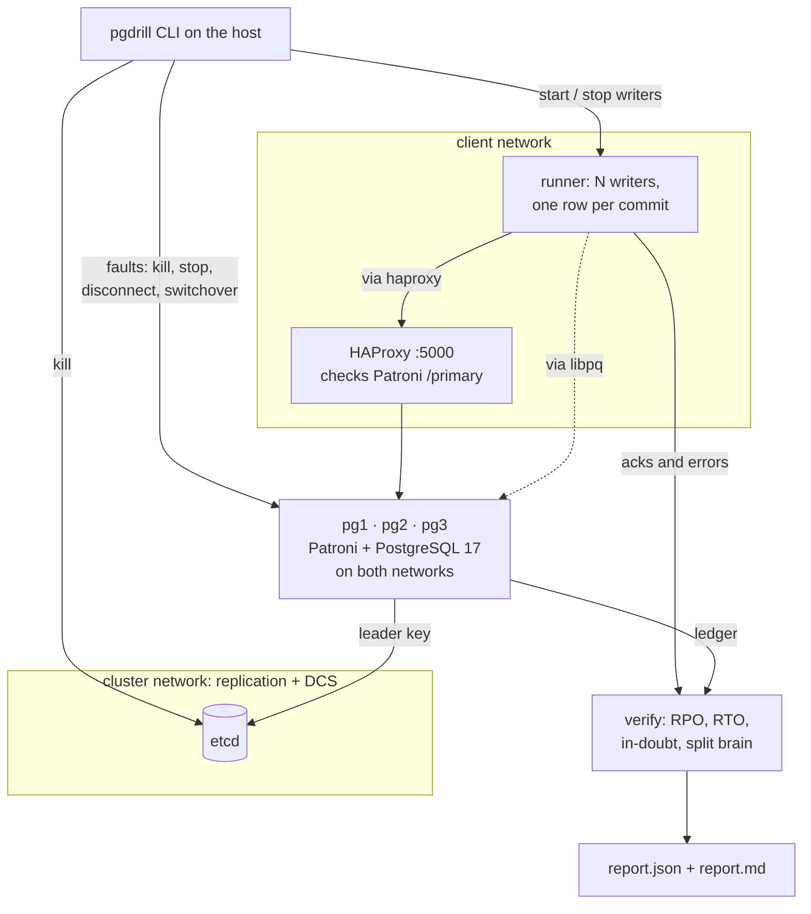

# pg-failover-drill

[](https://github.com/kiwifarmit/ol-sbx-pg-failover-drill/actions/workflows/drill.yml)

Failover drills for Patroni/PostgreSQL clusters. You get measured **RTO**,
**RPO**, **in-doubt commits** and **split-brain checks** for each failure type,
reported in Oracle Data Guard terms.

> **User story.** As the DBA responsible for an Oracle → PostgreSQL migration,
> I want to run repeatable failure drills against the planned Patroni setup and
> get RTO, RPO and split-brain results per failure type, in Data Guard terms,
> so that I can sign off the HA design and set SLAs before cutover.

- Headless: one CLI, JSON + Markdown output, CI-friendly exit codes. It can be
  driven by a person, a pipeline or an AI agent.
- Self-contained: a disposable 3-node Patroni + etcd + HAProxy lab on Podman.
  Synthetic data only. No Oracle needed.
- Exact: every write is identified, so lost writes are counted, not estimated.

Background: [docs/analysis.md](docs/analysis.md) (Oracle HA → PostgreSQL concept
mapping and the gap this fills), [docs/executive-summary.md](docs/executive-summary.md)
(the use case) and [docs/sample-report.md](docs/sample-report.md) (results from
real runs).

## How it works



1. The CLI brings up the lab in the requested replication mode (or reuses a
   healthy one).
2. N writer threads run *inside the lab's client network*. Each inserts
   `(run_id, writer_id, seq)` rows in autocommit and logs every acknowledged
   commit, every failed one and any still blocked at the end.
3. The CLI injects the fault, drives recovery (restart, reconnect) and waits
   until the cluster is back to 1 leader + 2 streaming replicas on the same
   timeline.
4. It reads the ledger from the surviving primary and compares:
   - **lost acked**: acknowledged writes that are gone. This is the RPO.
   - **max gap**: the longest period with no acknowledged write, including an
     outage that never ended. This is the RTO the application sees.
   - **in-doubt**: commits that never got a definite answer, and whether they
     survived.
   - **split brain**: an old primary that kept acknowledging writes after a new
     one started.

The client and cluster networks are separate (and `--internal`, so podman
doesn't route between them). A partition can therefore cut the primary off from
etcd and its peers while clients can still write to it, the situation in which
split brain and lost writes actually happen.

## Quickstart

Requirements: Podman 4.9+ (on macOS a running `podman machine`), Python 3.11+,
[uv](https://docs.astral.sh/uv/). Run from a checkout. On macOS the checkout must
be under a path the podman machine shares, such as your home directory.

```bash
git clone https://github.com/kiwifarmit/ol-sbx-pg-failover-drill.git && cd ol-sbx-pg-failover-drill
```

```bash
uv run pgdrill lab build
```

```bash
uv run pgdrill run --scenarios all --modes all --max-rto 45 --max-rpo 0
```

The report lands in `.pgdrill/runs/<timestamp>/report.md` (and `report.json`).
A full matrix (7 scenarios × 3 modes) takes about 20 minutes.

Other commands:

```bash
uv run pgdrill scenarios
```

```bash
uv run pgdrill lab up --sync-mode sync && uv run pgdrill lab status
```

```bash
uv run pgdrill run --scenarios kill-primary,switchover --modes async,sync --via haproxy,libpq
```

```bash
uv run pgdrill lab down
```

## Verdicts and exit codes

A run **fails** on any of these, whatever thresholds you set:

- the scenario itself errored
- writes never resumed. A healthy cluster doesn't end the measurement: the run
  keeps going until clients can write again (up to 60 s), because the proxy or
  the driver can lag behind Patroni
- split brain
- the cluster didn't heal
- writers were still blocked at the end
- ledger rows appeared that no client wrote
- an acknowledged write was lost in `sync` or `strict` mode (that is the
  guarantee those modes exist for)

`--max-rto` and `--max-rpo` add thresholds on top. Async write loss only fails
with `--max-rpo`.

Exit codes:
- `0`: all runs passed
- `2`: at least one run failed a check
- `1`: a run could not complete
- `130`: interrupted. The lab is removed and a partial report written.

## Scenarios

| Scenario | Fault | Oracle analogue |
|---|---|---|
| `kill-primary` | SIGKILL the primary container | Instance crash + Fast-Start Failover |
| `stop-primary` | Clean shutdown of the primary | Primary shutdown with FSFO |
| `switchover` | `patronictl switchover` | Broker SWITCHOVER |
| `partition-primary` | Cut the primary off from etcd and its peers (clients still reach it) | Primary isolated from observer and standbys |
| `dcs-loss` | Kill etcd for ttl+loop_wait+5s | Observer loss |
| `lagging-replicas-failover` | Cut both standbys off from the cluster network for 2s (WAL stops reaching them), then kill the primary | Failover with unshipped redo / `FastStartFailoverLagLimit` |
| `replicas-down` | Stop both replicas for ttl+5s | All standbys unreachable |

`lagging-replicas-failover` has two legitimate outcomes, and the report's
timeline says which one happened:

- **Failover** (the usual one). A standby is promoted, and in async whatever it
  never received is lost.
- **No failover.** Patroni sees both standbys more than
  `--max-lag-on-failover` (1 MB by default) behind, so it refuses to promote
  either one. The old primary comes back with its data and the outage lasts
  until then.

The timeline records how far behind each standby really was when the primary
died (`standby_lag_at_kill`).

The cut uses the network, not `podman pause`. Pausing freezes the standby's
processes, but the kernel keeps receiving WAL into its socket buffers, so the
standby catches up on unpause and nothing is lost.

In `sync`/`strict`, cutting off the standbys also stalls commits (the sync
standby can't confirm), so the write gap starts before the crash.

## Modes

| `--modes` | Patroni setting | Data Guard equivalent |
|---|---|---|
| `async` | default | Maximum Performance |
| `sync` | `synchronous_mode: true` | Maximum Availability |
| `strict` | `synchronous_mode_strict: true` | Maximum Protection (but Postgres blocks commits, it doesn't shut down) |

## Routing

- `--via haproxy`: HAProxy on port 5000 health-checks Patroni `/primary`
  (`inter 1s fall 2`), with `on-marked-down shutdown-sessions`.
- `--via libpq`: `host=pg1,pg2,pg3 target_session_attrs=read-write`. This is
  the closest PostgreSQL equivalent of a TNS `ADDRESS_LIST` with `FAILOVER=ON`.

## Tuning

Patroni timers are short by default so a drill takes about a minute:
`--ttl 20 --loop-wait 5 --retry-timeout 5`, with `failsafe_mode` on (`--no-failsafe`
turns it off). Set them to the values you plan for production to measure that
configuration instead. `loop_wait + 2 × retry_timeout` must not exceed `ttl`.

`--max-lag-on-failover BYTES` sets Patroni's `maximum_lag_on_failover`, the
counterpart of `FastStartFailoverLagLimit` (which is in seconds). Patroni
compares a standby's position with the leader LSN last written to the DCS,
and the leader writes it once per `loop_wait`. Up to `loop_wait` worth of WAL
can therefore be missing from a standby without the limit seeing it.

The writers use these client settings, and they shape every RTO number:

```
connect_timeout=2 tcp_user_timeout=3000 keepalives=1 keepalives_idle=1 keepalives_interval=1 keepalives_count=2
```

With libpq defaults instead, a client stuck on a dead or partitioned server can
wait for minutes (kernel TCP timeouts) before it tries another host. They are
defined in `src/pgdrill/runner.py` and recorded in every report.

## Layout

```
lab/                 Containerfile, Patroni and HAProxy templates
src/pgdrill/
  lab.py             podman lab lifecycle (two networks), Patroni /cluster health
  faults.py          scenario registry; restore steps run in finally blocks
  workload.py        writer threads (runs inside the lab's client network)
  probe.py           one-shot DB probes (runs inside the lab's client network)
  runner.py          starts workload/probe containers, client settings
  verify.py          RTO / RPO / in-doubt / split-brain analysis (pure functions)
  report.py          verdicts and the Markdown report
  drill.py, cli.py   orchestration and CLI
tests/               unit tests for verify and report; one podman integration test (-m podman)
```

The host side is stdlib only and drives the `podman` CLI. psycopg only runs
inside the lab image. Set `PGDRILL_PODMAN="sudo podman"` if rootless networking
gets in the way on your host.

Every lab container has a fixed MAC address derived from its IP. Without it, a
restarted node comes back with a new MAC, and peers keep sending to the old one
from their ARP cache. Older netavark releases (1.4, as on Ubuntu 24.04) don't
announce the new address. There, HAProxy couldn't reach a restarted node for
42 s, and a switchover to it looked like a 9–15 s outage.

Each run also saves the HAProxy and Patroni logs for its window under
`<run>/logs/`. HAProxy logs every health-check transition.

## Limitations

- The lab is not a production setup: trust authentication inside the lab
  subnets, a single etcd node, no TLS.
- Timings come from containers on one host. Network latency between real sites
  adds to every number, and results vary from run to run (the size of an async
  loss in particular depends on timing).
- The workload is single-row autocommit inserts. Long transactions and
  application-level retry logic are out of scope for now.
- It drives its own lab only. Pointing it at an existing staging cluster is on
  the roadmap.

## License

Apache-2.0. Made by [Kiwifarm](https://github.com/kiwifarmit).
